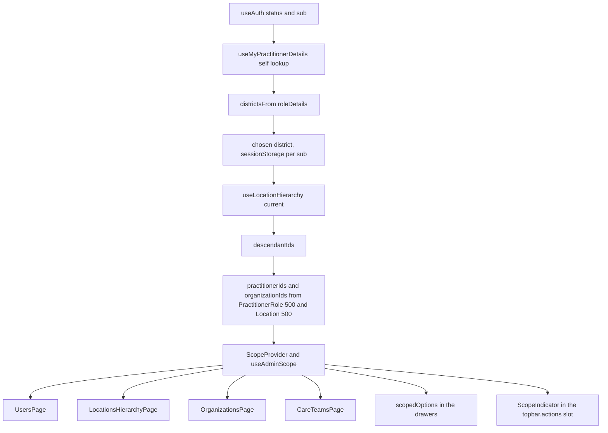

# District level admin scoping (#92), implementation plan

Scope covers the Users, Locations, Organisations and Care teams lists, an app bar indicator, and the pickers in the user drawers and the location create drawer.
Backend is `ohs-player-reference-backend` `main` at `d7182fc`. The commits after the local checkout are dependency bumps only and change nothing under `src/main`.
Base branch is `main` at `10a58b0`, and the work branch is `feat/admin-scope`.

This is a convenience filter. The backend does not enforce scope, so a scoped user calling the API directly still sees every record until the backend's role scoped endpoints land.

---

## 0. Analysis

### 0.1 What the web does today

| Screen | Calls today | Scope source after this ticket |
| --- | --- | --- |
| `UsersPage` | `Practitioner` with `name:contains` (500), `PractitionerRole` (500), `Organization` (500) | `practitionerIds` from the provider |
| `LocationsHierarchyPage` | `useLocationRoots()` for the dropdown, `useLocationHierarchy(root)` for the tree | the chosen district becomes the only root |
| `OrganizationsPage` | `Organization` with `_revinclude=Location:organization` (200), `Location` active (500) | `organizationIds` plus each row's managed locations |
| `CareTeamsPage` | `CareTeam` (200), `Practitioner` (500), `Organization` (500) | `organizationIds` and `practitionerIds` from the provider |
| `DashboardPage` | `_summary=count` searches | unchanged, a non goal |

Line references on `10a58b0`. `UsersPage.tsx` lines 151 to 153. `LocationsHierarchyPage.tsx` lines 126 to 132. `OrganizationsPage.tsx` lines 74 to 78. `CareTeamsPage.tsx` lines 58 to 60. `AppLayout.tsx` lines 121 to 140 hold `app-topbar__actions`. `PortalRoutes.tsx` line 53 passes `layoutChildren` into `AppLayout`.

### 0.2 Backend contract, verified from source

- `PractitionerDetailsServlet` answers the self lookup when no `iam-id` or `practitioner-id` is passed. It reads the caller's `sub` and needs no realm role. An explicit id needs `practitioner-details.view`.
- `PractitionerDetailService.resolvePractitionerIdFromIamId` searches `Practitioner?identifier=http://ohs.dev/identifiers/keycloak-user-id|{sub}` (`PractitionerService.KEYCLOAK_IDENTIFIER_SYSTEM`). No match answers `404` "No practitioner found for iam-id" at servlet line 106.
- A practitioner with no `PractitionerRole` also answers `404`, at servlet line 135 ("No practitioner found for id").
- Each `practitionerRoles[]` entry carries the role, its organisation and `locations[]` built from `role.getLocation()` against the `_include`d Locations (`PractitionerDetailService` lines 106 to 110).
- `/api/location-hierarchy/{id}` needs realm role `location-hierarchy.view`. `manager-user` holds it in `infra/keycloak/ohs-realm.json`.
- `OhsPlayerAccessChecker` decides by verb and resource type only. Nothing on the server narrows a list by location.

### 0.3 Findings that change the plan

**F1. `PortalHost` `children` render beside the router, not around it.** `PortalHost.tsx` renders `{children}` and then `<BrowserRouter>` as siblings. A provider passed as `children` would not reach the pages, the frame or any slot. Decided in D2 as a new additive `providers` prop.

**F2. Scope needs one hierarchy request, not one per district.** A user with several districts sees one at a time, so only the chosen district's tree is fetched. The provider calls `useLocationHierarchy(current)` once, under the same query key the Locations page uses. No component chain and no cap are needed.

**F3. The care teams page has no data to compute scope with.** It fetches neither `PractitionerRole` nor `Location`. The provider resolves `practitionerIds` and `organizationIds` once, for every page (D3).

**F4. `FhirClient` already reports every HTTP failure through the platform `onError`.** `FhirClient.toError` calls `onError` before it throws, and that includes the self lookup `404`. The provider therefore reports only failures that did not come from an HTTP response, such as a network error or a malformed hierarchy body. A deployment that wires `onError` to an error tracker will see one `404` report per sign in for every user with no practitioner. This is a consequence of calling the endpoint the issue names. A follow up covers it.

**F5. `useMyPractitionerDetails` cannot be switched off.** The provider sits above the sign in routes, so the hook gains an optional `enabled` argument and the provider passes `false` until the session is authenticated. Without it the sign in page would fire an unauthenticated request.

**F6. A scoped user costs one extra care team search.** When the endpoint attaches no care teams, `usePractitionerContext` also runs `CareTeam?participant=Practitioner/{id}`. A user with no practitioner never reaches it, so the unscoped path stays at one request.

**F7. No seeded user resolves to a practitioner today.** `admin-user` and `manager-user` have no fixed Keycloak `id`, and `scripts/seed.ts` writes `urn:demo:staff` identifiers and no `PractitionerRole`. Every user is unscoped on the local stack until the D5 seed data exists.

**F8. `docs/CORE_PUBLIC_API.md` documents the library only.** The slot table and `PortalHost` props are documented in `docs/EXTENDING.md`, so the new slot and prop are recorded there. The ticket asked for rows in both files.

**F9. The Locations page "load more" re-root looks broken on `main`.** `loadMore` calls `setRootId(childId)`, but `effectiveRoot` only keeps a `rootId` that appears in the roots list, which holds top level locations only. The tree falls back to the first root. This is outside this ticket and is listed as a follow up.

**F10. Overlapping work.** Open PR #111 edits `UsersPage.tsx`, `OrganizationsPage.tsx`, `CareTeamsPage.tsx` and `docs/ARCHITECTURE.md`. Open PR #113 edits `docs/EXTENDING.md`. Issue #90 has no PR yet, so Phase 5 waits for it or for an explicit go ahead.

### 0.4 Where the new code sits

| Layer | What this ticket adds |
| --- | --- |
| Library | An optional `retry` on `useCustomResource`, added after the live walk (B1). Additive. |
| Shell | `topbar.actions` in `SlotContexts` and `SLOT_NAMES`, a `Slot` in `AppLayout`, and an optional `providers` component on `PortalHostProps` that wraps the routes. Both additive. |
| Reference app | `features/scope/` with the pure scope model, the provider and hook, the indicator, the note and an in app manifest. Filters in four pages, the picker helper, an `enabled` argument on `useMyPractitionerDetails`, an `enabled` argument on `useLocationRoots`, i18n keys, seed data and docs. |
| Second app | Untouched. It must still build and pass `host.test.tsx`. |

---

## Reference or product

| Part | Bin | What gets built |
| --- | --- | --- |
| `useAdminScope`, descendant expansion, the four list filters, the enforcement statement, seed data, docs | Reference | All of it. |
| App bar indicator and the district picker | Borderline | A read only chip for one district, a `Listbox` for more than one, the choice in `sessionStorage` per `sub`. No cross device memory. |
| Picker scoping and the new location parent default | Borderline | One pure `scopedOptions` function reused by both user drawers and the location create drawer, plus the parent default. |
| Per role scope rules, scoped dashboard counts, scope aware global search, a scope management screen | Product | Not built. Enforcement belongs to the backend ticket, and a deployment that needs more adds it through an extension. |

---

## Decisions as taken

| # | Decision | Outcome |
| --- | --- | --- |
| D1 | Where the indicator renders | A new `topbar.actions` slot. `AppLayout` renders `<Slot name="topbar.actions" context={{}} />` before `GlobalSearch`. The reference app installs an in app `scope` manifest that contributes the indicator. It reads the app's own scope context, so it is an app owned contribution and not a portable extension. |
| D2 | How scope reaches the lists | A `ScopeProvider` mounted through a new optional `providers` component on `PortalHostProps`. It wraps the routes inside the router and the platform providers, so the pages, the drawers and the top bar slot read one value. Pages outside a provider read an unscoped default, which keeps every existing page test valid. |
| D3 | Server or client filtering | Client side. When scoped, the provider runs `PractitionerRole` with `_count=500` and `Location` with `_count=500&status=active`, the same query keys the Users and Organisations pages use, so TanStack serves both from one request. The UI note and the docs state the cap. |
| D4 | Remembering the chosen district | `sessionStorage` per `sub`, so it is per tab and clears when the tab closes. A stored id that no longer matches a role falls back to the first district and is removed. |
| D5 | Test data | `manager-user` gets a fixed `id` in `infra/keycloak/ohs-realm.json`, approved in session. `scripts/seed.ts` writes a matching Practitioner, a `PractitionerRole` at `Location/seed-loc-district`, and records outside the district for the filter to hide. An existing Keycloak container needs `docker compose up -d --force-recreate keycloak` once. |
| D6 | Failure behaviour | A `404` from the self lookup means unscoped, exactly as on `main`. Any other self lookup failure means unscoped with a one line notice in the indicator. A failed hierarchy request keeps the user scoped to the district id alone, without descendants, and the note says the scope is incomplete. A user known to be scoped never sees more because a request failed. |

---

## FHIR R4 facts relied on

| Fact | Source |
| --- | --- |
| `PractitionerRole.location` is `0..*` `Reference(Location)`. `PractitionerRole.organization` and `PractitionerRole.practitioner` are `0..1`. `PractitionerRole.period` is `0..1`. | <https://hl7.org/fhir/R4/practitionerrole.html> |
| `PractitionerRole` search parameters `location`, `organization` and `practitioner` exist, all of type reference. | <https://hl7.org/fhir/R4/practitionerrole.html#search> |
| A comma separated value in one parameter is an OR search. | <https://hl7.org/fhir/R4/search.html#combining> |
| `Location.managingOrganization` is `0..1` `Reference(Organization)` and `Location.partOf` is `0..1` `Reference(Location)`. Search parameters `organization` and `partof` exist. | <https://hl7.org/fhir/R4/location.html#search> |
| `CareTeam.managingOrganization` is `0..*` `Reference(Organization)`. `CareTeam.participant.member` is `0..1` and may reference Practitioner, PractitionerRole, RelatedPerson, Patient, Organization or CareTeam. No `CareTeam` search parameter targets Location. | <https://hl7.org/fhir/R4/careteam.html#search> |

D3 keeps the searches the pages already run, so this ticket adds no new search parameter. The `location` parameter on `PractitionerRole` is the server side path once the backend scopes its queries.

---

## Scope model

- **Districts** are the distinct locations across the signed in user's roles, from the inlined `locations[]` and from `practitionerRole.location[].reference` when a Location was not inlined. `Location/123` and `123` normalise to `123`.
- **Location ids** are every node in the chosen district's tree, the district included.
- **Practitioner ids** are the practitioners of every `PractitionerRole` with a location in scope.
- **Organisation ids** are the `managingOrganization` of every in scope Location, plus the `organization` of every `PractitionerRole` with a location in scope.
- **A care team is in scope** when a `managingOrganization` is an in scope organisation, or a `participant.member` is an in scope practitioner, role or organisation. A bare member id is read as a Practitioner, matching how the page already reads members.
- **An organisation is in scope** when its id is in the set, or a Location it manages, from the page's `_revinclude`, is in scope. The second rule reaches locations past the 500 cap.

---

## Edge cases

| Case | Answer | Proof |
| --- | --- | --- |
| No Practitioner for the signed in user (`404`) | Unscoped, identical to `main`, one request | `ScopeProvider.test.tsx` counts requests through focus and reconnect, `useResolvedScope.test.tsx` checks no tree or search is asked for |
| Practitioner with no role (`404` at line 135) | Unscoped | same test |
| A role with no `location` | Contributes nothing. All roles without a location means unscoped | `scope.test.ts` |
| A role whose location is not a hierarchy root | The tree is fetched with that location as root, and the Locations page shows it as the only root | page test |
| Two roles sharing a location | One district | `scope.test.ts` |
| Truncated tree (`meta.truncated` or a node with `hasMoreChildren`) | Scope is incomplete and the note says so | `useResolvedScope.test.tsx` and `ScopeNote.test.tsx` |
| Hierarchy fails (`403`, `5xx`) | Scoped to the district id alone, note says incomplete | provider test |
| Self lookup fails other than `404` | Unscoped with a notice in the indicator | provider test |
| `PractitionerRole` beyond the first 500 | Its practitioner reads as out of scope. The note and the docs say the list is capped | documented |
| Organisation that manages no in scope location and is named by no in scope role | Out of scope | `scope.test.ts` |
| Care team with no in scope organisation and no in scope member | Out of scope | `scope.test.ts` |
| End dated `PractitionerRole` (`period.end` in the past) | Still counts until the role is removed. Left to the backend ticket | documented |
| Stored district no longer among the roles | Falls back to the first district and clears the stored value | provider test |
| References as `Type/id` or bare `id` | Both normalise | `scope.test.ts` |
| Role list changes between renders | Hook count is fixed, no conditional hooks | provider re-render test |
| Two tabs with two districts | Expected, because `sessionStorage` is per tab. Documented | documented |

---

## Assumptions

1. A scoped user works in one district at a time.
2. Scope follows the roles a user holds, whatever their permissions. An `admin` with a location role is scoped too.
3. `PractitionerRole.active` and `period` are not read. The backend ticket decides whether an inactive role grants scope.
4. An inactive Location does not bring its managing organisation into scope for the care teams page, because the shared `Location` search asks for `status=active`. The Organisations page still matches it through `_revinclude`.
5. The self lookup runs once per session, with no refetch on focus or reconnect (B2). The district's tree keeps `staleTime: Infinity` and refreshes only through the Locations page's own create, import, edit and retry paths. A role change, or a tree change made elsewhere, shows after a reload. The `PractitionerRole` and `Location` searches behind the people and organisation sets refetch on focus as before, so those sets can change during a session.

---

## Phases

Every step ends in one commit that leaves `pnpm typecheck`, `pnpm lint` and `pnpm test` green. After any shell change the example app is built and tested too.

### Phase 0, this plan

- `docs/ADMIN_SCOPE_PLAN.md`
- Commit `docs: plan district level admin scoping`

### Phase 1, scope model, pure and tested first

- `apps/ohs-player-web/src/features/scope/scope.ts` with `idOf`, `districtsFrom`, `descendantIds`, `resolveScopeIds`, `organizationInScope`, `careTeamInScope`, `scopedOptions`. `districtsFrom` carries the district ids, so no separate location id function exists. `resolveScopeIds` returns the practitioner, role and organisation sets in one pass. The Users page reads `practitionerIds` directly, so no practitioner predicate exists.
- `apps/ohs-player-web/src/features/scope/scope.test.ts`
- Commit `feat(scope): pure scope resolution from practitioner roles and the location tree`

### Phase 2, the providers prop, then the provider and hook

- Shell `host/PortalHost.tsx` gains `providers?: ComponentType<{ children: ReactNode }>`, with JSDoc and a `PortalHost.test.tsx` case. `docs/EXTENDING.md` documents it.
- Commit `feat(shell): let an application wrap the routes in its own providers`
- App `features/scope/ScopeProvider.tsx`, `useAdminScope.ts` (context, unscoped default, `rowsInScope`), `useResolvedScope.ts`, `useCurrentDistrict.ts` (the `sessionStorage` choice), and `useResolvedScope.test.tsx`. The i18n keys arrive with the indicator and the note that use them, so no key ships unused.
- `features/users/usePractitionerDetails.ts` gains the `enabled` argument on `useMyPractitionerDetails`
- `App.tsx` passes `providers={ScopeProvider}`
- Commit `feat(scope): resolve the signed in user's district scope once per session`

### Phase 3, the indicator in the app bar

- Shell `host/types.ts` gains `'topbar.actions': Record<string, never>` and the name in `SLOT_NAMES`. `layout/AppLayout.tsx` renders the slot. Cases in `types.test.ts` and `Slot.test.tsx`. `docs/EXTENDING.md` lists the slot.
- Commit `feat(shell): topbar.actions slot`
- App `features/scope/ScopeIndicator.tsx`, `manifest.ts`, `manifest.test.ts`, the indicator test, and the install line in `extensions.ts`. The indicator stays mounted while a newly chosen district's tree loads, so a keyboard user switching districts keeps focus on the picker. Its copy lives in `appMessages.ts` because the pages share it, so the manifest declares no `messages`.
- Commit `feat(scope): district indicator and picker in the app bar`

### Phase 4, the lists, one commit and one test per page

- `features/scope/ScopeNote.tsx`, rendered once under each page header
- `UsersPage.tsx`, `features/locations/LocationsHierarchyPage.tsx` (with `enabled` on `useLocationRoots`), `OrganizationsPage.tsx`, `CareTeamsPage.tsx`, each with a scoped and an unscoped test case
- Commits `feat(scope): filter the users list`, `feat(scope): root the locations tree at the district`, `feat(scope): filter the organisations list`, `feat(scope): filter the care teams list`

### Phase 5, create flows, after #90

- Rebase onto `origin/main` and read the #90 diff first. Editing the user drawers before #90 merges needs an explicit go ahead.
- `scopedOptions` applied to `locOptions` and `orgOptions` in `useUserCreateForm.ts` and `UserEditDrawer.tsx`, keeping values already selected
- `LocationCreateDrawer.tsx` scopes the parent options and defaults the parent to the district. `LocationForm.tsx` gained an optional `emptyParent`, so a cleared parent falls back to the district (B4)
- Commit `feat(scope): scope the pickers in the user drawers and default a new location's parent`

### Phase 6, seed data, docs, live walk

- `infra/keycloak/ohs-realm.json` fixed `id` for `manager-user`, and `scripts/seed.ts` data
- Commit `feat(seed): a district scoped practitioner for manager-user`
- `docs/ARCHITECTURE.md` scope section, `docs/QUICKSTART.md` scoped sign in, `docs/EXTENDING.md` worked example
- Commit `docs: describe admin scope as a convenience filter`

### Phase 7, bug hunt

Findings and fixes recorded below, each fix with a regression test and a `fix(scope): ...` commit.

### Phase 8, push and pull request

Full gates, push, and a pull request that opens with `Fixes #92`.

---

## Live walk

Run on 21 October 2026 against HAPI on `:8080`, Keycloak on `:8090`, the gateway built from `ohs-player-reference-backend` on `:8180`, the reference app on `:5173`, and `pnpm seed` data. A headless Chrome signed in through Keycloak. The running Keycloak predates the fixed `manager-user` id, so for this walk the seeded practitioner's identifier was pointed at the live id instead of recreating the container. The next `pnpm seed` restores it.

| Check | `manager-user`, scoped | `admin-user`, unscoped |
| --- | --- | --- |
| App bar | `Demo District` chip, with the convenience note for screen readers | Nothing |
| Users | Two rows, District Manager and Seed User1, with the note under the header | Every practitioner, no note |
| Locations | Tree rooted at Demo District, no root picker | Tree rooted at Demo Country, root picker shown |
| Organisations | Demo Health Organization only | Both organisations |
| Care teams | Primary Care Team only | Both care teams |
| Add user pickers | Organisation offers Demo Health Organization. Location offers Demo District, Demo Facility and Demo Clinic. Nothing preselected | Unchanged code path, covered by tests |
| New location | Parent defaults to Demo District and offers only the district and its descendants | Unchanged code path, covered by tests |
| `/api` requests | One `practitioner-details` and one `location-hierarchy/seed-loc-district` | One `practitioner-details` after B1, plus the Locations page's own tree |
| axe with colour contrast, light and dark | `label-content-name-mismatch` on the user menu trigger and `empty-table-header` | The same two, so both are pre-existing |

The Add user and New location checks granted `users.create`, `users.edit` and `locations.edit` to `care-team-manager` by intercepting `/portal-config.json`, because the seeded manager holds none of them. No file or record changed for that.

## Bug hunt

**B1. An unscoped user waited about seven seconds for every list (fixed).** Found in the live walk. `admin-user` made four self lookup requests. `CorePlatformProvider` builds a default `QueryClient`, which retries a failed query three times with backoff, and the lists hold their rows while scope loads. A `404` is the definitive unscoped answer, so the library's `useCustomResource` gained an optional `retry` (approved in session) and the self lookup passes one that never retries a `404`. Tests in `useFhirData.test.tsx` and `usePractitionerDetails.test.tsx`. The live walk then showed one request.

The rest was a separate review over the finished branch. It read every changed file in full, checked each item of the ticket's bug hunt list, and proved its bugs with throwaway tests, which it deleted afterwards.

**B2. An unscoped user's lists went blank and the `404` was sent again on every window focus or reconnect (fixed).** A failed query holds no data, so TanStack counts it as stale and refetches it on focus and reconnect, and the refetch puts it back to pending. The library's `useCustomResource` gained optional `refetchOnWindowFocus` and `refetchOnReconnect` (approved in session), the self lookup turns both off, and the provider now counts scope as loading only until the self lookup and the tree first settle. `ScopeProvider.test.tsx` runs the real client against a stubbed gateway and counts one request through focus and reconnect.

**B3. A self lookup failure other than `404` held every list blank for about seven seconds (fixed).** B1 still allowed three retries for any other status. The self lookup now retries once. `ScopeProvider.test.tsx` reaches unscoped with the notice after two requests.

**B4. Clearing the parent in the location create drawer while scoped created a root location outside the district (fixed).** The parent picker fell back to the root on clear, which a scoped user is not offered. `LocationFormFields` takes an optional `emptyParent`, and the create drawer passes the district. `LocationCreateDrawer.test.tsx` submits after a clear and gets `partOf` the district.

**B5. A create drawer opened while scope was loading was not scoped and never took the district as its parent (fixed).** `scopedIds` waited for `scoped`, and the form read its initial parent once. `scopedIds` now applies as soon as the district is known, which only ever narrows, and the create form remounts when the district becomes known. Two tests in `LocationCreateDrawer.test.tsx`.

**B6. A scoped location create walked the whole store for root locations it never showed (fixed).** An explicit `refetch` ignores `enabled`. It now runs only while the roots are shown. Two tests in `LocationsHierarchyPage.test.tsx`.

**B7. Docs that did not match the code (fixed).** The plan claimed a provider test counted requests and that the self lookup never refreshed. Both are now true and say which test proves them. The plan's library row is corrected.

**B8. Small fixes.** A versioned original link (`Location/x/_history/2`) was not kept in the edit drawer's picker, now it is, with a test. The district picker could not shrink in the app bar, now it can. The incomplete note said "could not be read" for a tree the gateway truncated, it now says "was not loaded". `ScopeNote.test.tsx` covers the note with and without `incomplete`. Formatting churn in `AppLayout.tsx` and an unneeded console spy in `Slot.test.tsx` are gone.

Risks recorded, not changed.

- **R1. Freshness.** See assumption 5.
- **R2. Records a scoped admin creates can leave their list.** A user created with no location in the district, or an organisation or care team created with no in scope link, disappears after the success message. Follow up 8.
- **R3. Phone width.** At 360 px the app bar is 489 px wide on `main` and 597 px with the district chip. The overflow predates this ticket. Follow up 9.
- **R4. Switching district with a drawer open** is not reachable, because `Drawer` is a modal Radix dialog that blocks the app bar. Create pickers keep any value already chosen in state.
- **R5. Other pickers stay unscoped**, as the plan chose. Follow up 10.
- **R6. The Users role chip** offers every role code. Follow up 11.
- **R7. The self lookup cache key does not carry the user.** Not reachable today, because sign in and sign out both reload the page.
- **R8. A slot contribution that throws** shows a full error block in the app bar, which is the existing `ContributionBoundary` contract.

Checked and fine. Hook order through changing role lists. The `404` path asks for no tree and no search. A hierarchy `403` keeps the user scoped to the district with the incomplete note on every page, and the Locations page shows its no access state with Retry. Truncation sets `incomplete`. Bare, typed, absolute and versioned references normalise. Edit user keeps an original out of scope link. Create user never preselects. `useCurrentDistrict` resets on a new `sub`, survives a throwing `sessionStorage` and is safe under StrictMode. Memo dependencies are complete. A district switch shows progress without a stuck state, and the indicator stays mounted. The `Slot` assertion is sound, the `providers` prop wraps only the routes, and the example app is untouched and passes. Every new message key is used and declared, with no hardcoded copy. The doc counts match the seed.

---

## Files intentionally not touched

- `packages/ohs-player-web-core` beyond the `retry` option that B1 needed.
- `DashboardPage.tsx` and the shell's dashboard counts, a non goal.
- The shell's global search, which stays unscoped.
- `docker-compose.yml`. The local change in the working tree is not part of this branch.
- `ohs-player-reference-backend`. Enforcement is its own ticket.
- `apps/ohs-player-web-example`, which must pass unchanged.

## Follow ups worth ticketing

1. Backend enforcement through role scoped admin endpoints, the non goal of #92.
2. Scoped dashboard counts, which need scoped `_summary=count` queries.
3. Scope aware global search.
4. Server side scoped searches once the backend can answer them, replacing the 500 row caps.
5. The self lookup `404` reaches `onError` once per sign in for every user with no practitioner (F4). Either a way for a call to mark a status as expected, or a `200` with no roles from the backend.
6. The Locations page "load more" re-root falls back to the first root (F9).
7. Refreshing scope when a role or the tree changes during a session.
8. A record a scoped admin creates without an in scope link leaves their list after the success message (R2). Defaulting the Add user location to the district would close most of it.
9. The app bar overflows at phone width on `main` already (R3). The district chip adds about 108 px to it.
10. The location edit drawer's parent, the organisation form's location picker and the care team form's pickers stay unscoped (R5).
11. The Users role chip lists every role code, not only those in scope (R6).

## Risk assessment

| Risk | Mitigation |
| --- | --- |
| Two shell contract additions (`topbar.actions`, `providers`) | Both optional and additive. Example app built and tested after each. |
| Unscoped users see a change | The default context is unscoped, the self lookup is the only new request and never repeats, and `ScopeProvider.test.tsx` counts requests. |
| A scoped user briefly sees every row | Pages treat a loading scope as loading and render no rows until it settles. |
| Hook order changes with the role list | One hierarchy hook, one search per type, no hooks in loops. A re-render test changes the role list. |
| Merge conflicts with #111, #113 and #90 | Small, page level edits. Rebase before Phase 5 and before the pull request. |
| Realm change ignored on an existing container | `docs/QUICKSTART.md` gives the recreate command. |
